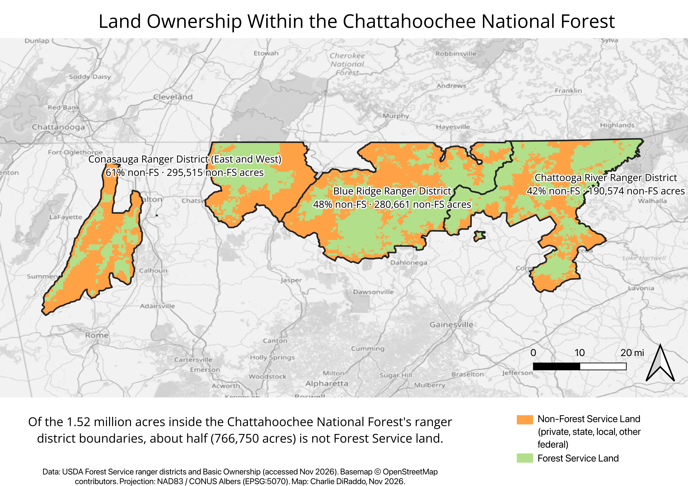

# Land Ownership Within the Chattahoochee National Forest

## Question

National forest boundaries on a map look solid, but much of the land inside them is owned by someone other than the Forest Service. How much of each Chattahoochee ranger district is actually non-Forest Service land?

## Finding

Of the 1.52 million acres inside the Chattahoochee National Forest's ranger district boundaries, about half (766,750 acres) is not Forest Service land.

| Ranger district | Non-FS share | Non-FS acres |
| --- | --- | --- |
| Conasauga (east and west units) | 61% | 295,515 |
| Blue Ridge | 48% | 280,661 |
| Chattooga River | 42% | 190,574 |
| **Total** | **~50%** | **766,750** |

For a visitor who is unfamiliar with public land management, the boundaries of a forest can be confusing. This map helps explain why land access can be patchy inside ranger district boundaries. Maps of the Chattahoochee that use only the administrative boundary roughly double the apparent size of public land, so a visitor may assume land is public when it isn't. Next steps would be breaking "non-FS" into its actual owners (private, state, other federal) and looking at how the Forest Service has acquired land over time.

## Data

- Ranger district boundaries: USDA Forest Service, Ranger District Boundaries (`BdyAdm_LSRS_RangerDistrict`), accessed Nov 2026. [Download](https://data.fs.usda.gov/geodata/edw/datasets.php) · [Metadata](https://data.fs.usda.gov/geodata/edw/edw_resources/meta/BdyAdm_LSRS_RangerDistrict.xml)
- Forest Service ownership: USDA Forest Service, Basic Ownership (`BdyOwn_LSRS_BasicOwnership`), accessed Nov 2026. [Download](https://data.fs.usda.gov/geodata/edw/datasets.php) · [Metadata](https://data.fs.usda.gov/geodata/edw/edw_resources/meta/BdyOwn_LSRS_BasicOwnership.xml)
- Basemap: © OpenStreetMap contributors (shown in grayscale)

## Method

Tools: QGIS 3.44.15 (Solothurn)

1. Loaded the ranger district and Basic Ownership layers; ran Fix Geometries on both.
2. Fixed a projection error: one layer was labeled EPSG:5070 but its coordinates were still in degrees. Set its CRS to EPSG:4269 (what the coordinates actually were), then reprojected to EPSG:5070 (NAD83 / CONUS Albers), an equal-area projection, so acreage is accurate. An earlier intersection built on the mislabeled layer was discarded and rebuilt.
3. Intersected the non-Forest Service ownership with the district boundaries to get non-FS land within each district.
4. Calculated acres with the Field Calculator: `area(@geometry) / 4046.8564224`, stored as a real field.
5. Summed non-FS acres by district (Statistics by Categories), joined the sums to the districts layer, and calculated `pct_nonfs = 100 × non-FS acres ÷ total district acres`.

## Limits

- Ownership boundaries come from the Forest Service Basic Ownership layer, digitized from maps and imagery or GPS-collected. The agency does not warrant their accuracy, so acreages are approximate.
- "Non-FS" is not the same as "private": it includes state, local, and other federal land (e.g. Army Corps). The data doesn't say who owns it.
- Ownership is not the same as management: the Forest Service also works on non-FS land through partnerships (e.g. fire, conservation easements, watershed projects), which this map doesn't show.
- Covers the three Chattahoochee ranger districts only; the Oconee National Forest is not included.
- Ownership data changes as the Forest Service buys and sells land; figures reflect the layer as accessed in Nov 2026.

## Files

- `chattahoochee-ownership.png`: final map (300 dpi)
- `chattahoochee-ownership.pdf`: final map
- `chattahoochee-ownership.qgz`: QGIS project (source data not included; download from the links above)
